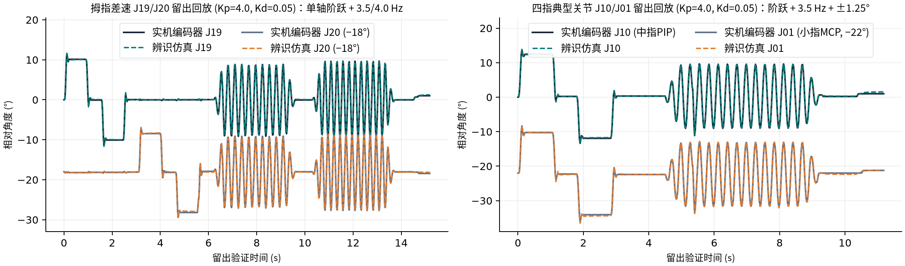
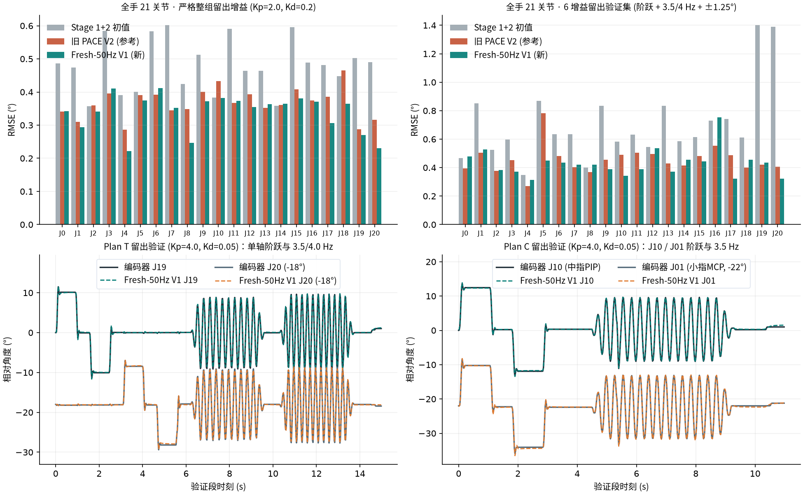

# REVO3-SysID: BrainCo REVO3 Ultra21 全手 21 关节闭环动力学辨识与仿真资产一键导出

面向 **BrainCo REVO3 Ultra21（右手，21-DOF）** 灵巧手的开箱即用闭环系统辨识（System Identification）工具包。  
只需要 `git clone` 下来，即可**直接对你的 REVO3 灵巧手进行安全采数、2.5 分钟完成全手 21 关节辨识，并自动导出可直接用于 MuJoCo 与 Isaac Lab / Isaac Sim / Newton 的仿真资产**；如果你暂时不想采数，也可以直接使用仓库内置的预辨识模型（`results/fresh50hz_v1/`）。

> **实机严格留出验证精度（Fresh-50Hz，7 组正交 MIT 增益，21 次实机采集）：**
> - **严格留出增益** (`Kp=2.0, Kd=0.2`，训练期完全未见过)：全手 21 关节平均闭环 RMSE = **`0.338°`**
> - **6 组训练增益的留出轨迹段**（阶跃 / 高频扫频 / ±1.25° 微脉冲）：全手 21 关节平均 RMSE = **`0.436°`**
> - **大拇指 45° 差速耦合关节 (`J19 / J20`)**：留出验证 RMSE = **`0.251° / 0.384°`**（单轴阶跃跨轴耦合实测 `0.47°/0.35°` vs 仿真 `0.51°/0.42°`）
> - **辨识速度（Option A 多核 C 混合引擎）**：24 核 CPU 全手 21 关节仅需 **~2.5 分钟**（原生 `gcc -O3` C 滚动核 + 2ms CMA-ES 全局搜索 + 1ms 并行雅可比高斯牛顿精修）



---

## 目录导航

- [1. 快速安装与 3 秒零硬件自检](#1-快速安装与-3-秒零硬件自检)
- [2. 直接使用预辨识好的 MuJoCo 与 Isaac Lab 资产](#2-直接使用预辨识好的-mujoco-与-isaac-lab-资产)
- [3. 对你自己的 REVO3 灵巧手做全手辨识（小白 4 步）](#3-对你自己的-revo3-灵巧手做全手辨识小白-4-步)
- [4. 核心技术特性与三阶段辨识架构](#4-核心技术特性与三阶段辨识架构)
- [5. 常见问题（30 Hz 能否复用？独立打包怎么导出？）](#5-常见问题30-hz-能否复用独立打包怎么导出)
- [6. 仓库结构与 PDF 技术报告](#6-仓库结构与-pdf-技术报告)

---

## 1. 快速安装与 3 秒零硬件自检

> 系统要求：Linux（推荐 Ubuntu 22.04/24.04），Python ≥ 3.10，安装 `gcc` 可自动启用 5.2× 原生 C 加速核（无 `gcc` 时自动回退，不影响功能）。

```bash
git clone https://github.com/tannjieee/revo3-sysid.git
cd revo3-sysid

# 1. 创建虚拟环境并安装核心包（纯仿真 / 辨识 / 资产导出）
python3 -m venv .venv
source .venv/bin/activate
pip install -e .

# 2. 如果要连接真实 REVO3 灵巧手采数，再安装官方 SDK（要求 bc-revo3-sdk==2.3.2）
pip install -e ".[hardware]"

# 3. 零硬件 3 秒自检：验证内置 MuJoCo XML、Isaac Lab USD 与预辨识模型
revo3-sysid demo
```

看到 `All bundled MuJoCo & Isaac Lab assets are verified and ready to use!` 即表示环境就绪。

---

## 2. 直接使用预辨识好的 MuJoCo 与 Isaac Lab 资产

仓库已在 [`results/fresh50hz_v1/`](results/fresh50hz_v1/) 打包好了完整的预辨识结果与仿真资产，所有路径均为**相对路径**，开箱即用：

| 资产文件 | 适用仿真器 | 说明 |
| --- | --- | --- |
| [`results/fresh50hz_v1/revo3_right_identified.xml`](results/fresh50hz_v1/revo3_right_identified.xml) | **MuJoCo** | 已写入全手 21 关节 `armature / damping / frictionloss / stiffness / springref` 与 J19/J20 45° 差速肌腱 |
| [`results/fresh50hz_v1/revo3_right_identified.json`](results/fresh50hz_v1/revo3_right_identified.json) | **Python / 闭环引擎** | 完整 21 通道辨识参数（含 `kp_scale / kd_scale / vel_mult / delay_s / i²t 热限流`） |
| [`results/fresh50hz_v1/revo3_right_identified.usda`](results/fresh50hz_v1/revo3_right_identified.usda) | **Isaac Sim / Isaac Lab / Newton** | 轻量 OpenUSD sublayer（自动引用 [`assets/revo3_right/revo3_right.usd`](assets/revo3_right/revo3_right.usd)，写入 PhysX 关节参数） |
| [`results/fresh50hz_v1/isaaclab_revo3_cfg.py`](results/fresh50hz_v1/isaaclab_revo3_cfg.py) | **Isaac Lab** | 即插即用 `ArticulationCfg` 工厂（提供 `DelayedPD`、`Implicit` 与完整 `45°差速+i²t` 三种执行器） |
| [`results/fresh50hz_v1/isaaclab_actuator_params.json`](results/fresh50hz_v1/isaaclab_actuator_params.json) | **自定义框架** | 21 关节逐一对应的 Isaac Lab / PhysX 参数 JSON 表 |

### 2.1 在 MuJoCo 中直接加载

```python
import mujoco

# 方式 A：直接加载带辨识动力学参数的 MuJoCo XML
model = mujoco.MjModel.from_xml_path("results/fresh50hz_v1/revo3_right_identified.xml")
data = mujoco.MjData(model)
print(f"Loaded REVO3: njnt={model.njnt}, nu={model.nu}, ntendon={model.ntendon}")

# 方式 B：使用完整的闭环执行器引擎（含 MIT 延迟 + 45° 差速 + i²t 热限流）
from revo3_sysid import Revo3ClosedLoopConfig, Revo3ClosedLoopModel, default_xml_path, default_pretrained_json

cfg = Revo3ClosedLoopConfig.load(default_pretrained_json())
sim = Revo3ClosedLoopModel(default_xml_path("right"), cfg, finger="full")
```

### 2.2 在 Isaac Lab 中直接加载

```python
import sys
sys.path.append("results/fresh50hz_v1")

from isaaclab_revo3_cfg import (
    make_revo3_delayed_pd_cfg,           # 标准 Isaac Lab DelayedPDActuatorCfg（无需自定义类）
    make_revo3_implicit_cfg,             # 轻量 ImplicitActuatorCfg（适合高吞吐 RL 训练）
    make_revo3_differential_thermal_cfg, # 高保真：GPU 批处理 45° J19/J20 差速 + i²t 热限流
)

# 1) 标准 RL 训练推荐（自动按你的 MIT Kp/Kd 换算刚度与阻尼，并按 sim_dt 换算延迟步数）
robot_cfg = make_revo3_delayed_pd_cfg(kp_cmd=2.0, kd_cmd=0.2, sim_dt=0.002)

# 2) Sim-to-Real 高保真回放 / 精细操作（需在 Isaac Lab 环境中 pip install -e .）
robot_cfg_exact = make_revo3_differential_thermal_cfg(kp_cmd=2.0, kd_cmd=0.2, sim_dt=0.002)
```

> **提示（独立导出到其他工程）**：如果你想把资产完整拷贝到另一个独立仓库（包含所有 mesh、纹理和 `revo3_right.usd`，不依赖本仓库目录），运行：
> ```bash
> revo3-sysid export \
>   --config results/fresh50hz_v1/revo3_right_identified.json \
>   --out /path/to/your_project/revo3_assets \
>   --standalone
> ```

---

## 3. 对你自己的 REVO3 灵巧手做全手辨识（小白 4 步）

> ⚠️ **实机操作前安全检查清单**
> 1. 将 REVO3 右手**稳固夹持固定**，确保手掌与五指四周净空无障碍物；
> 2. 准备好电源开关，随时可一键断电；
> 3. 确认用户有串口读写权限（如 `sudo usermod -aG dialout $USER`）；
> 4. 本工具**默认处于 Dry-Run（仅校验、不动电机）模式**，必须显式传入 `--run` 才会驱动硬件；每次采集结束都会强制下发 `software_stop()` 并独立重连回读确认锁存。

### Step 1：扫描设备与读取健康状态（纯只读，安全）

```bash
# 扫描 RS-485 总线上的 REVO3 设备
revo3-sysid scan

# 查看当前 21 关节角度、电流、故障码及 software_stop 状态
revo3-sysid status
```

> 如果断电状态下手指自然下垂导致个别关节略超限位（例如食指轻微下垂超下限 1.5°），轻轻托正手指即可通过上电前检查。

### Step 2：Dry-Run 预检轨迹（不动电机）

```bash
# 完整 7 增益方案（21 次采集，约 12 分钟，推荐）
revo3-sysid collect --mode full --out captures/my_hand

# 或快速 3 增益方案（9 次采集，约 5 分钟，适合快速标定）
revo3-sysid collect --mode quick --out captures/my_hand_quick
```

所有内置激励轨迹（`plans/plan_C` 四指、`plan_D` 拇指近端、`plan_T` 拇指差速及过渡轨迹）均已通过 MuJoCo 凸包自碰撞检测（`plans/screen_report.json`）。

### Step 3：实机采数（加上 `--run`）

```bash
# 若上次结束后 software_stop 处于锁存状态，加上 --recover-stop 自动解锁
revo3-sysid collect --mode full --out captures/my_hand --run --recover-stop
```

采集完成后会自动生成 `captures/my_hand/manifest.json`。

### Step 4：一键辨识并自动导出 MuJoCo + Isaac Lab 资产

```bash
revo3-sysid fit \
  --dataset captures/my_hand \
  --out outputs/my_hand_v1 \
  --kp-cmd 2.0 --kd-cmd 0.2 --sim-dt 0.002
```

约 **2.5 分钟**（24 核 CPU）后，`outputs/my_hand_v1/` 目录将直接生成：
- **MuJoCo 资产**：`revo3_right_identified.xml`、`revo3_right_identified.json`
- **Isaac Lab 资产**：`revo3_right_identified.usda`、`isaaclab_revo3_cfg.py`、`isaaclab_actuator_params.json`
- **验证报告与图表**：`evaluation_summary.json`、`per_joint_scores.csv`、`by_gain_scores.csv`、`validation_summary.png`

（如需完全独立可搬移文件夹，在命令末尾追加 `--standalone` 即可。）

---

## 4. 核心技术特性与三阶段辨识架构

1. **Layer 1 实时控制内核（零 4 Hz 抖动）**：
   - 采用绝对相位锁定调度（`scheduled += period`）与 `stream_trajectory()` 逐帧同步写入；
   - 将慢速配置读回从热循环解耦，50 Hz 实际频率稳定在 `50.04 Hz`（`p50=20.00 ms, p95=21.14 ms`，0 跳帧）。
2. **Layer 2 物理闭环仿真引擎**：
   - **MIT 电流律与传输延迟**：
     $$u_{\text{des}} = k_{p,s} K_p (q_{\text{cmd}}(t-\tau_d)-q) + k_{d,s} K_d (v_{\text{mult}}\dot{q}_{\text{cmd}}(t-\tau_d) - \dot{q}) + b$$
   - **大拇指 `J19/J20` 45° 正交差速肌腱**：通过 $T = \frac{1}{\sqrt{2}}\begin{bmatrix}1 & 1\\ 1 & -1\end{bmatrix}$ 将关节空间误差与电流映射到物理双电机模态；
   - **漏积分 `i²t` 动态热限流**：同时刻画瞬时峰值电流 $i_{\text{peak}}$ 与持续限流 $i_{\text{cont}}$，消除高增益阶跃过冲与平台漂移；
   - **原生 `gcc -O3` C 滚动核**：首次运行自动编译缓存至 `~/.cache/revo3-sysid/`，比 Python 循环快 **5.2×** 且误差 `< 1e-11`。
3. **三阶段解耦辨识流水线**：
   - **Stage 1（电学律辨识）**：多增益未饱和区带约束最小二乘直接测定 $k_{p,s}, k_{d,s}, v_{\text{mult}}, b, \tau_d$；
   - **Stage 2（力学初值估计）**：基于 MuJoCo `mj_inverse` 逆动力学线性回归得到各关节惯量、阻尼、库仑摩擦与弹性回位初值；
   - **Stage 3（Option A 混合闭环精修）**：锁定 Stage 1 尺度消除退化，先以 `dt=2ms` 多核 CMA-ES 全局跳出局部极小并确定离散延迟，再以 `dt=1ms` 并行雅可比 Trust-Region Gauss-Newton（`scipy.optimize.least_squares`）收敛。



---

## 5. 常见问题（30 Hz 能否复用？独立打包怎么导出？）

- **Q1：我平时用 30 Hz 控制频率，这套 50 Hz 辨识的参数还能直接用吗？**  
  **可以！** 辨识出来的物理力学参数（惯量、阻尼、库仑摩擦、肌腱刚度）和底层电机电学参数（$k_{p,s}, k_{d,s}, i^2 t$ 限流、45° 差速）都与上层发送频率无关。只要仿真时按真实 **30 Hz 零阶保持（ZOH）** 更新指令、物理仿真步长保持 `dt = 1~2 ms`、通信延迟 $\tau_d$ 仍按真实毫秒数设置即可；唯一区别是 30 Hz 下平均多引入约 $\frac{1}{2}(33.3 - 20) \approx 6.7\text{ ms}$ 的采样保持延迟，若高增益高频动作出现相位滞后，可微调 `kp/kd` 或在真机上用 30 Hz 补采 1 组验证。

- **Q2：如何把辨识结果导出成一个可以直接发给同事的独立文件夹？**  
  在 `fit` 或 `export` 时加上 `--standalone`，会自动把所有 MuJoCo meshes、textures 以及 `revo3_right.usd` 复制到目标文件夹并写好相对路径。

- **Q3：运行测试套件**
  ```bash
  pip install -e ".[dev]"
  pytest -v
  ```

---

## 6. 仓库结构与 PDF 技术报告

```text
revo3-sysid/
├── assets/revo3_right/          # MuJoCo MJCF (148 meshes) + 官方 Isaac Lab/PhysX/Newton USD
├── plans/                       # 碰撞预筛后的 50Hz 全手激励轨迹 (Plan C/D/T + 过渡轨迹)
├── results/fresh50hz_v1/        # 预辨识好的 V1 资产（MuJoCo XML/JSON + Isaac Lab USDA/Cfg + 图表）
├── docs/                        # 完整中文 PDF 报告
│   ├── REVO3_Fresh50Hz_辨识简报.pdf
│   └── REVO3_Fresh50Hz_底层架构重构与全手21关节辨识报告.pdf
├── src/revo3_sysid/             # 独立可安装的 Python 包 & CLI
└── tests/                       # 34 项单元测试（设备安全、控制内核、C 核一致性、Isaac Lab 导出）
```

## 致谢与许可

本项目采用 [MIT License](LICENSE) 开源。部分 CMA-ES 优化器及硬件抽象设计参考并致谢 `aiowuji`（Younghyo Park, MIT License）。
